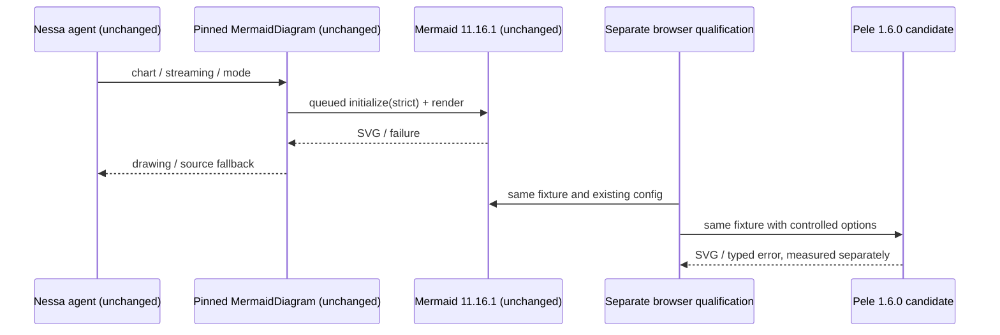
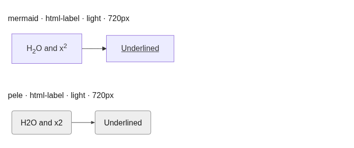
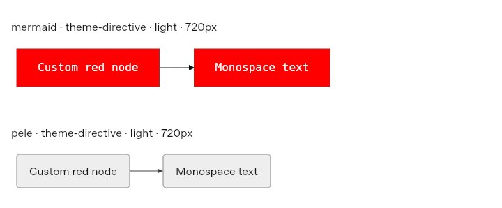

# Pele renderer qualification — #134

**Recommendation: keep Mermaid in production.** Pele is promising for an explicit,
limited opt-in, but a default replacement would silently discard supported label
semantics and source-defined themes/fonts. This branch changes no product code,
package dependencies, registry output, public exports, or nessa-agent revision pin.

## Ownership and existing behavior

Inspected nessa-agent `e650b901` and nessa_ui
`0794a41bb1482aa7e677fd2b7012874bcc3e29b2` on 2026-10-17. The agent's
`nessa-ui-revision` names that UI commit. Its `package.json` links the UI package
from `.vendor/nessa_ui`; `scripts/ensure-nessa-ui.mjs` owns preparing that pin.
The implementation belongs in
[`MermaidDiagram`](../../../packages/react/src/components/mermaid-diagram.tsx),
not the desktop transcript or gateway.

The current component accepts anything Mermaid parses, uses Mermaid 11.16.1,
and serializes `initialize()` plus `render()` through a shared queue. Strict
security, suppressed error drawings, light/dark themes and the dark edge-label
contrast override apply. A 250 ms debounce, 10 second queue deadline/quarantine,
streaming reveal/final-source fallback, copy, and fullscreen viewer surround it.
The app does not invoke the returned `bindFunctions`.



## Provenance, maintenance and license

The [official site](https://pele.run/) links to
[obsidianmd/pele](https://github.com/obsidianmd/pele), and documents the npm name
`pele`. [Version 1.6.0 metadata](https://registry.npmjs.org/pele/1.6.0)
names that repository, no runtime dependencies, ESM exports and Node >=20.
The source repository was created October 5, 2026; its latest release was
published October 17. Active releases and parser compatibility/fuzz tests are
positive signals, but this is roughly twelve days of public maintenance history.

The downloaded tarball's SHA-512 was recomputed and matched npm's integrity.
The decoded npm SLSA statement names the official release workflow, tag 1.6.0,
and commit `659c3593ce43794dce7ec7ab45d424ad2de182a5`. That agrees with the
GitHub release source. **Attestation signatures were not independently verified.**
The historical `pele@1.0.0` was an unrelated package; do not infer provenance from
the name or install an old unconstrained version. See [provenance.json](provenance.json).

The actual [LICENSE](https://github.com/obsidianmd/pele/blob/659c3593ce43794dce7ec7ab45d424ad2de182a5/LICENSE)
contains MIT and an ISC notice for a Lucide icon. Mermaid-derived compatibility
specs are also described as MIT by upstream. No material licensing blocker was
found; preserve the supplied notices if distributing Pele. GitHub's aggregate
license classification is `NOASSERTION`, which does not replace reading the file.

## Comparison and blockers

The fixtures compare renderer output, not a modified Nessa app. The candidate
uses `images:false`, a unique accessibility prefix for its one drawing, and
`autoDirection:false`, plus fixture-only CSS variables. Safe URL links retain
Pele defaults. Disabling all links would have broken the existing safe-link
fixture: strict Mermaid's returned SVG still contains that anchor.

| Area | Observed result / implication |
| --- | --- |
| Diagram families | 23 family smoke examples render in both engines: flowchart, sequence, class, state, ER, Gantt, git graph, pie, mindmap, timeline, journey, quadrant, XY, requirement, Sankey, architecture, C4 Context, block, kanban, packet, radar, treemap and info. This is not grammar equivalence or coverage of every C4 variant. |
| HTML labels — blocker | Current Mermaid preserves subscript, superscript and underline. Pele strips those tags: `H₂O` / `x²` become `H2O` / `x2`. Both report rendering success. Upstream `src/text/label.ts` confirms only bold/italic tag styles are retained. Error fallback cannot detect this loss. |
| Theme/font directives — blocker | The source's red `primaryColor` and monospace `themeVariables.fontFamily` apply in Mermaid. Pele returns the host's gray surface and sans-serif. Upstream explicitly documents that Mermaid theme colors do not apply. Source-defined visual meaning can disappear without an exception. |
| Host theme and fonts | Pele's CSS color variables are attractive and the fixtures set them per mode. Its synchronous render API accepts measured fonts; `mount()` reads CSS/fonts and owns resize/font observers. A future adapter must pass Nessa font tokens consistently to layout and drawing, wait for font loading or use mount's lifecycle, and carry the same theme into the fullscreen dialog. No production token mapping or delayed-font qualification is implemented here. |
| Layout | Positions, sizes and subgraph direction differ. Both widths are recorded, including a 150-edge chain. Pele's responsive direction changes are deliberately disabled here; upstream may adapt LR to vertical when maxWidth/mount is used. No pixel-equivalence or clipping guarantee is claimed. |
| Accessibility | Explicit accTitle/accDescr and root role are preserved in the checked fixture. Each instance must have unique IDs. This is metadata verification, not screen-reader or complete accessibility qualification. |
| Errors / limits | The malformed final source fails in both; Pele exposes a syntax code. A >50,000-character comment-heavy source renders in Mermaid after preprocessing but trips Pele's raw-source limit. Source, output and edge limit policies require explicit adapter decisions. One 150-edge graph is not worst-case workload qualification. |
| Links / untrusted labels | Safe URL anchors remain; javascript anchors and executable attributes/scripts are absent in the sampled outputs. No injected flag fires after the bounded observation. Images are disabled in the candidate. These are limited probes, not sanitizer equivalence or a security audit. |
| CSS URL probe | The style-injection fixture is rejected by both parsers; it proves nothing about accepted CSS URL sanitization. |

Pele's [compatibility](https://pele.run/compatibility),
[API](https://pele.run/api), [theming](https://pele.run/theming), and
[security](https://pele.run/security) documentation explain the intended differences.
Its renderer escapes text and filters links/styles instead of using Mermaid's
DOMPurify path. Icon resolver markup is trusted caller input. Internal links need
app navigation policy; raw errors must be text. A synchronous render on the main
thread cannot be interrupted by the current queue's timer; a terminable worker
would be needed for a real execution deadline. These boundaries must be reviewed
before replacing the present queue or injecting output in both viewer surfaces.

## Evidence and reproduction

`fixtures.json` has 33 static examples; the script adds the large chain and source
limit cases. Chromium and WebKit each run 35 fixtures × 2 modes × 2 widths.
[`evidence/results.json`](evidence/results.json) retains statuses, bounded text,
SVG dimensions, metadata, fonts/fills, attributes, links, external request attempts
and renderer-only timing. Timings exclude final SVG insertion and the observation delay; renderer-internal
DOM work remains included. They use fixed ordering;
**do not interpret them as a performance benchmark.** The server permits only
local package reads; external browser requests are recorded and aborted. Relative
resource requests are not classified as external attempts.




Use already-reviewed package installations; this script does not fetch or install
anything. The baseline package directory must be Mermaid 11.16.1 and candidate
must be Pele 1.6.0 when using the checker. The runner records actual manifest and
browser versions, and fails explicitly for blocked engines or runtime stages.

```sh
node docs/investigations/pele/compare.mjs \
  /path/to/mermaid /path/to/pele /path/to/playwright/index.mjs /tmp/pele-results
node docs/investigations/pele/check-results.mjs /tmp/pele-results/results.json
```

The recorded run uses Node 24.19.0, Playwright 1.57.0, Chromium 143 and WebKit 26
on Debian 13. The checkout has no node_modules. Reviewed official npm packages
were staged under `/tmp`, with install scripts disabled. The fixture run uses
plain Node, not repository package-manager commands. Missing system libraries were
extracted from this environment's configured Debian snapshot into `/tmp` and linked
into the temporary WebKit bundle. Playwright's ldconfig-based host check could
not see those staged libraries, so `PLAYWRIGHT_SKIP_VALIDATE_HOST_REQUIREMENTS=1`
was used after an actual browser/page launch succeeded. No system package install
or app data change occurred. Early blocked runs are not passing evidence.

Final run: 280 comparison rows, no blocked engines. The result checker passes
for both engines; changing a candidate family result to failed in a temporary
copy makes the same checker fail. Both Node syntax checks and `git diff --check`
pass. The core evidence assertions print:

```text
ok chromium: 23 family smoke fixtures, label/theme blockers, accessibility metadata, malformed source and limited injection probes
ok webkit: 23 family smoke fixtures, label/theme blockers, accessibility metadata, malformed source and limited injection probes
ok checker negative control: failed candidate family is rejected
```

No component, Storybook, packaging or registry contract changed, so the full UI
suite and desktop production harness were not run. This evidence does not cover
streaming transitions, fullscreen focus/pan/zoom, production frame budgets,
WKWebView on macOS, custom icon providers, plugins, fuzzing, all parser variants,
font loading, or comprehensive sanitization. Those remain requirements for an
actual product switch. Two independent read-only review rounds inspected the
comparison scripts; R1's three harness findings were fixed, R2 had zero actionable
findings. No deployment, merge or app integration is included.

## Smallest safe next step

Keep Mermaid as the default. If pursuing Pele now, add an explicitly selected,
lazy adapter for a bounded diagram subset, retaining Mermaid for existing content.
Do not select the candidate solely with `supports()` or successful parsing: those
checks identify a diagram family, not supported label/config semantics. Agree an
opt-in compatibility contract first, then fixture-test its accepted syntax and
fallback decisions. Avoid a second handwritten Mermaid parser to guess fidelity.
Preserve source/streaming/copy/viewer behavior, safe-link semantics and a controlled
resource policy. Map Nessa tokens once, keep IDs unique across inline/viewer copies,
and separately qualify deadlines and disposal.

All changes here are under `docs/investigations/pele`. There is no overlap with
nessa-agent #914/#960's product UI or shared verification files. The parent must
coordinate a future UI PR, agent pin update, current-main integration and review;
this investigation branch is not authorization to merge or deploy.
