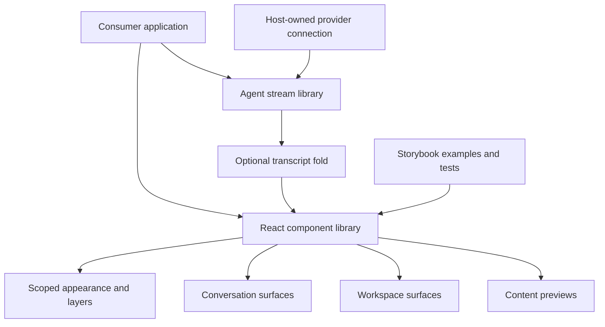

# Build a Nessa interface

Nessa UI supplies React components and a separate agent-event parser. An application supplies its own data, agent connection, persistence and business decisions. Storybook demonstrates compositions; it is not the production Nessa chat application.

For example, a host can parse an agent event stream, fold it into turns, render tool rows and ask a person for approval. The approval card reports a UI action; the host must send the decision to its agent and update the card from the outcome it knows. A disappearing card is not evidence that a tool was authorized or stopped.

| Your goal                                         | Start here                                            |
| ------------------------------------------------- | ----------------------------------------------------- |
| Install components, styles or copied source       | [Consumer surfaces](distribution.md)                  |
| Set theme, inputs, focus and layout               | [Interface foundations](services/interface/README.md) |
| Compose chat, queues, approvals and reading views | [Conversation surfaces](services/chat/README.md)      |
| Build tables, boards, charts or multiple windows  | [Workspace surfaces](services/workspace/README.md)    |
| Preview files, inspect code or show pairing art   | [Content surfaces](services/content/README.md)        |
| Turn provider events into a transcript            | [Agent-stream library](services/streams/README.md)    |
| Find every public family                          | [Feature ownership inventory](inventory.md)           |
| Understand actual checks and model limits         | [Verification](verification.md)                       |

This map covers the public families exported at the recorded source checkpoint and selected internal owners whose lifetime affects those APIs. Contract pages do not invent states for plain values or presentation primitives. The inventory distinguishes those contracts from modeled operations and from external host work.
