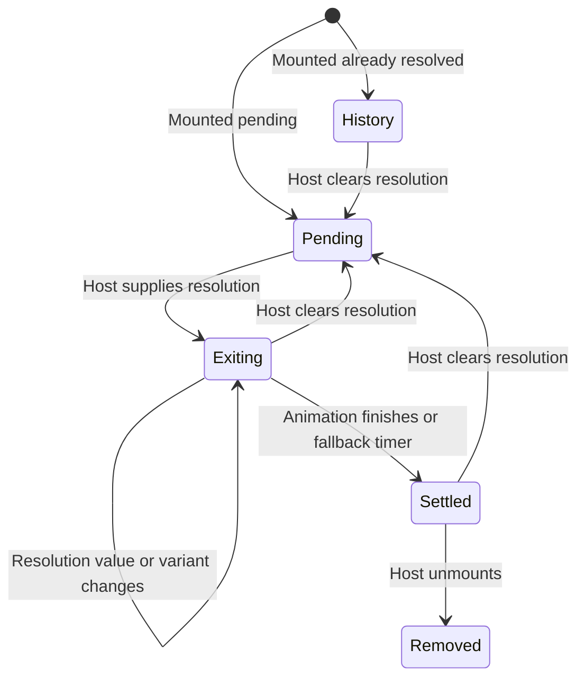

# Show a decision and finish its exit

ToolApproval presents a pending decision supplied by a host. Choosing allow or deny must be connected to host logic; setting `resolution` makes the card inert and starts its exit. `onExited` tells the host when to remove the visual card, not whether a remote tool accepted the answer.

A pending card that becomes resolved exits once. A card mounted already resolved represents history, so it does not play an exit or report `onExited`. A responsive variant change or allowed-to-denied flip during exit does not restart the animation. Clearing resolution returns to pending and permits a later decision to start a new exit.

## What exit completion means

The exit uses the variant chosen when it begins and reports at most once for that resolution period. Reduced motion or a zero duration settles immediately. Otherwise an animation completion or a duration-plus-50ms timer can settle it; this timer is a fallback because a hidden document's animation timeline may not finish. Browser timer scheduling can still delay a callback, so the value is not a real-time deadline guarantee.

Cleanup cancels the old animation/timer and guards its callbacks. A cancelled older exit must not report completion after the card has returned to pending. Settling transfers the end appearance to CSS and retires the owned animation; the host still owns unmounting. Unmounting the card does not cancel agent work or revoke a permission.

ToolApproval scope menus share resolution state even across portals. Questionnaire gathers answers under supplied field identities; the host sends those answers and interprets rejection. Neither UI validates a provider's authorization result.

The selected model uses two decision periods and races between finish, timer and cancellation. It checks one report per period and refusal of a stale period's completion. It excludes actual browser animation/focus behavior and server approval.
