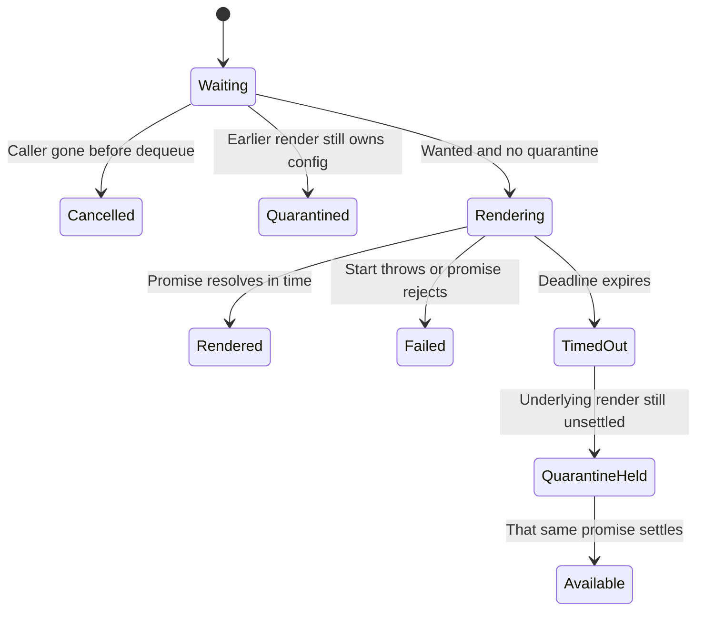

# Render diagrams without sharing a race

MermaidDiagram queues diagram rendering because Mermaid initialization changes shared configuration. One active render must finish before another can initialize a different theme. An unresponsive render falls back to source instead of leaving every later caller waiting forever.

For example, diagram A starts and never settles. Its deadline begins when it leaves the queue, not while waiting behind another job. When the deadline expires, A returns timed-out and the queue advances. The actual Mermaid render cannot be aborted, so the queue enters quarantine: later jobs return quarantined without calling initialize or render. Only settlement of A's underlying Promise lifts that quarantine.

## What timeout and cancellation leave behind

TimedOut and Quarantined do not mean Mermaid stopped. They release the caller's wait while protecting shared configuration. A render that never settles can keep new rendering unavailable for the page's module lifetime; there is no timeout-based forced reset. The component can show source fallback, and a future attempt can render only after quarantine clears. The queue does not automatically rerun a refused job.

The caller's `stillWanted` check runs once at dequeue. If the component disappears after start, the job retains its deadline and the actual render retains its ownership. Cleanup cannot undo that work. The queue identifies the exact Promise that raised quarantine before clearing it, so an unrelated late settlement cannot clear a newer owner's protection.

The bounded model abstracts two render identities, job start, timeout and underlying settlement. It checks that new rendering never overlaps an unsettled owner and a timed-out underlying render retains quarantine until it settles. The exact-Promise cleanup guard is source-reviewed, not separately modeled. It does not execute Mermaid or prove visual output. Existing unit tests exercise the real queue using controlled promises/clocks; those are part of the executed unit suite.
