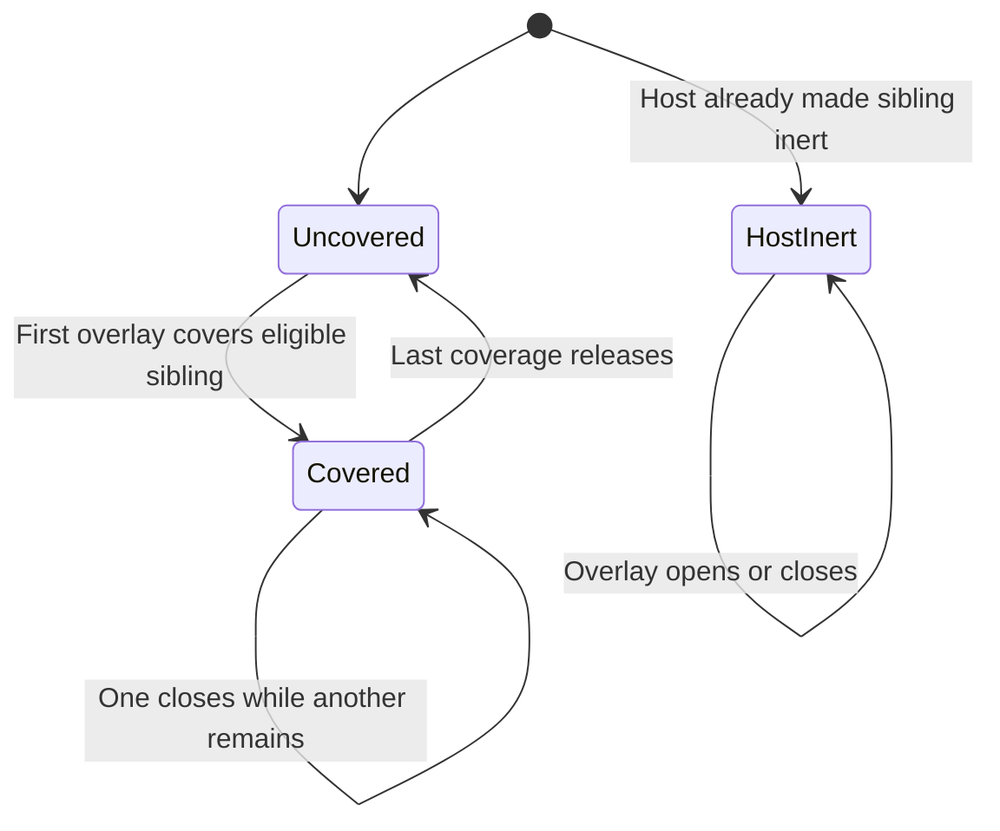

# Open a reading view over chat

ChatOverlay covers its positioned reading region while leaving surrounding chat controls usable. It moves focus into the view and covers its siblings, but it is explicitly nonmodal: Tab is not trapped and a composer outside that region remains reachable.

For example, open an annotation list and then its source document. Both can cover the same transcript element. Closing either one must leave the transcript inert while the other still covers it. The owner counts coverage per element and removes its inert attribute only when the final covering overlay releases it.

## What remains reachable

Dialog siblings and elements already inerted by the host are excluded from the overlay's coverage ownership. The host's inert attribute is therefore not removed when the overlay closes. A mutation observer covers newly mounted siblings and releases detached ones. Cleanup disconnects that observer, releases this overlay's covers, then returns focus to the connected opener or calls `onReturnFocus` when the opener is gone.

Escape inside the view calls its host close callback after the host's key handler has a chance to prevent it. A child control can stop propagation to consume Escape. A nested portaled menu with its own document listener may close along with the reading view unless the host handles propagation deliberately. This is not the modal ChatAttachmentViewer contract.

ChatAnnotations, ReferenceCard, ChatTray and selection tools provide the passage, comment and open/remove affordances. The host stores annotations and resolves source documents. Closing a reading view does not discard a saved annotation or cancel remote work.

The model covers two overlays and one underlying element, including an initially host-inert element. It checks that one release cannot expose content another overlay still covers and that host-owned inertness survives. It does not prove browser focus restoration or dynamic DOM observation.
