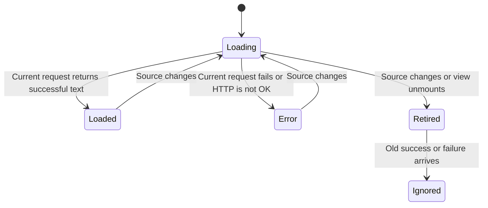

# Preview a changing file safely

FilePreview accepts a URL descriptor or a Blob/File and chooses a renderer. When the selected text file changes, the old request is cancelled and its late completion must not replace the new file's contents.

Give exactly one of `file` or `blob`; development builds warn if both or neither are supplied. For a Blob, the component creates and later revokes its own object URL. During a Blob swap it reports no URL until the new Blob has a matching one, so new metadata is not briefly paired with the old content. URLs supplied by the host remain the host's responsibility.

## What changing the file cancels

Text, Markdown, JSON and CSV previews share `useFileText`. Its effect starts fetch with an AbortController. Cleanup aborts, and the text callback checks the signal even when the Promise chain already resolved before abort. An old error is also ignored. The guarantee is refusal of stale callback publication after cleanup; it does not claim that every network byte or server operation is undone. A source change schedules a new effect, rather than returning a synchronous new file body.

Current fetch failures produce an error state without automatically retrying. Changing the source or remounting creates another attempt; the host can present a retry policy, but the hook does not choose one. A loaded text response is not proof that JSON/CSV syntax or a media decoder will succeed.

Built-in renderers cover image, PDF, video, audio, Markdown, JSON, CSV and text. Office formats and camera RAW can be detected but need a host renderer/conversion pipeline; otherwise they use fallback. MIME and extension detection are identity hints, not decode validation. HEIC/HEIF support depends on the browser. An explicit `kind` or renderer map can override routing. Header download is a link with an optional callback, not proof the browser saved a file.

The model uses two fetch generations and delayed success/error callbacks; it checks that publication uses the currently active generation. It abstracts the post-cleanup boundary and excludes transport cancellation guarantees, actual browser decoders and format parsing. Executed unit tests cover kind detection and delimited-text parsing, not this React fetch hook in a browser.
