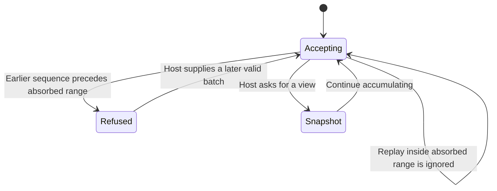

# Fold a live or saved conversation

TranscriptBuilder turns ordered normalized events into turns, tool results, delegated runs and pending questions. The host supplies liveness separately: absence of a result while a process is running differs from absence after the host knows it stopped.

For a saved log that may be shuffled, `buildTranscript` orders by sequence before folding. For live input, keep one TranscriptBuilder and push newly mapped events in arrival order. A configured session ID filters a shared bus to the conversation being shown. Without that filter the builder folds whatever arrives; it does not discover the intended session.

## Replay is not arbitrary reordering

The builder remembers its lowest/highest absorbed sequence. A value within that range is treated as replay and ignored; one below the range throws. This relies on the intended ordered event stream. It is not a generic event-ID deduplicator and cannot fill a previously omitted hole by later inserting its sequence. A thrown push may follow earlier absorbed events in the same batch; there is no transactional rollback of that batch. Use a fresh one-shot fold for shuffled persisted input.

Snapshot `events` and `resultByCallId` intentionally retain growing collection identities. Memoize derived data using `revision`, which advances per absorbed event, rather than reference equality. Turns and delegated run event arrays are assembled/copied for their view, but a snapshot is not a deep frozen copy of every collection.

## Who decides a tool is no longer pending

A real new user message abandons open calls on its own agent path; a main-thread message does not abandon a subagent's calls. A later result removes that call's abandoned marker and stores the result. When snapshot is requested with `live=false` (the default), remaining open calls appear abandoned. The host must pass `live=true` while appropriate; the builder does not inspect a process. Delegated run completion also considers host-supplied `liveTaskIds`, whose task IDs differ from spawning call IDs.

Main and delegated plans/usage remain separately owned. Permission decisions remove pending asks by request ID. The fold groups consecutive visible same-tool calls, keeps stable turn keys and removes the closing duplicate answer from work rows so the final text is not printed twice. It does not execute a tool, persist history, revoke a permission or guarantee that a late external result will arrive.

The bounded model covers two agent paths and two call identities for abandonment/result correlation. It checks that a new prompt only abandons its own open calls and an actual result clears abandonment. Replay behavior is source-documented and exercised by existing tests; it is not silently claimed as a modeled ordering proof. Fixture tests compare incremental and one-shot views, but no live provider process was started for this atlas.
